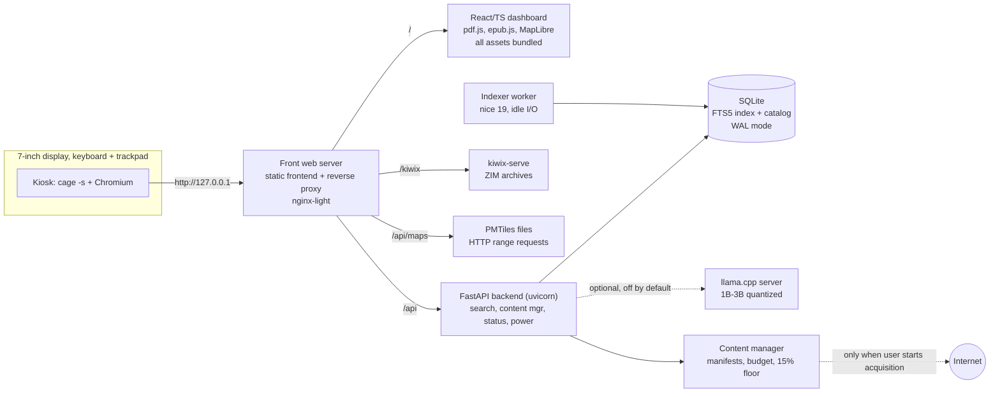

# SURVIVAL OS architecture

Status: **draft**. Implemented so far: the Phase 1 tooling, the dashboard, system status, power
controls, the kiosk and web services, and the manifest validator. See [STATUS.md](STATUS.md).

## Goals in one paragraph

A Raspberry Pi 5 (8 GB, one 1 TB NVMe in an external USB
enclosure, 7-inch 1024x600 display, keyboard or trackpad, and touch;
see [HARDWARE.md](HARDWARE.md)) boots Raspberry Pi
OS Lite 64-bit (Debian 13 trixie) straight into a full-screen browser that
shows the SURVIVAL OS dashboard. Everything (search, document viewers, Kiwix,
maps, optional AI) is served from `127.0.0.1` with no network dependency.
Network use happens only during development and user-started content
acquisition.

## Runtime components



Every box on the Pi is a systemd unit with `Restart=on-failure`, bounded
journald logs, and the least privileges it needs.

| Unit (planned) | Purpose | Default |
|---|---|---|
| `survival-kiosk.service` | Compositor + browser on tty1 as an unprivileged `kiosk` user, auto-restart | enabled |
| `survival-web.service` | Static files, reverse proxy, range requests for PMTiles, bound to 127.0.0.1 | enabled |
| `survival-api.service` | FastAPI app as `survival` user | enabled |
| `survival-indexer.service` | Background, throttled, resumable indexing | enabled |
| `kiwix-serve.service` | ZIM library on 127.0.0.1 | enabled once a ZIM is installed |
| `survival-llm.service` | llama.cpp server | **disabled** |
| `survival-share.service` | Wi-Fi hotspot / LAN exposure via NetworkManager | **disabled** |
| `survival-maintenance.target` | Stops the kiosk and gives tty1 a login prompt | on demand |

## Key design rules

- **Offline by construction.** The frontend build bundles all JS, CSS, fonts,
  map glyphs, sprites, and styles. CI will fail the build if any built asset
  references an external URL (Phase 9 check; planned in Phase 3).
- **One filesystem, one budget.** The content manager reads real capacity with
  `statvfs` (non-root usable size, excluding ext4 reserved blocks) and refuses
  any operation that would cross the 15% free floor, counting temp,
  decompression, index, and snapshot space before it starts. The same formula
  already runs in `scripts/pi/inspect_hardware.py`.
- **Power-loss safe.** SQLite in WAL mode with `synchronous=NORMAL`, downloads
  to `*.part` files with resume, then checksum, then atomic `rename`. Indexing
  commits in small batches and records progress per file.
- **Search vs. ZIM search.** Library search (FTS5) covers PDF/EPUB/TXT/MD/HTML
  files. Kiwix keeps its own full-text index inside each ZIM. The UI labels
  these separately and hands off a query to Kiwix in one tap. No claim of
  unified ranking.
- **AI is optional and removable.** The library never calls the LLM. AI answers
  must cite retrieved passages. Medical, wild-edible, and electrical-safety
  content always comes from sourced documents, never from model output.
- **Secure defaults.** All services listen on loopback. Admin actions need a
  local admin PIN, set at first use, and refuse cross-site requests. LAN sharing is off, SSH is disabled in the
  release image, and there are no credentials in Git or the image.

## Kiosk decision (Phase 2)

**Choice: `cage -s` running Chromium.** Measured on the target Pi 5 from NVMe, 2026-10-30, using
the same local page. Each pairing ran once, except cage with Chromium, which ran twice.

| Stack | Memory added after 30 s | Compositor RSS | WebGL renderer reported |
|---|---|---|---|
| cage + Chromium | 135 and 251 MiB | 81 MiB | V3D 7.1 through ANGLE |
| labwc + Chromium | 222 MiB | 96 MiB | V3D 7.1 through ANGLE |
| cage + Firefox | 1001 MiB | 84 MiB | "Generic Renderer" |

- Chromium over Firefox: about a fifth of the memory, and it confirms the GPU for MapLibre.
  Firefox may mask its renderer name, so hardware rendering there is unconfirmed, not disproved.
- cage over labwc: the two runs of cage differ by more than cage and labwc do, so memory does not
  separate them. cage wins on simplicity: it shows one application, needs no configuration, and
  exits when the browser does, which leaves restart handling to systemd.
- Stability: with `Restart=always`, two forced browser kills recovered in 3.5 s and 3.0 s.
  Long-duration stability is untested.

Requirements for the kiosk unit:

- Pass `-s`. Without it, cage blocks Ctrl+Alt+F2, the way out to a text console.
- Handle resize. The window is smaller at first load, then reaches 1024x600.

## Maintenance path out of the kiosk

See [MAINTENANCE.md](MAINTENANCE.md).

## Original maintenance plan

1. Dashboard → System → **Maintenance mode**: switches to
   `survival-maintenance.target`, which stops the kiosk and starts a getty on tty1.
2. Keyboard: **Ctrl+Alt+F2** switches to a text console at any time (VT
   switching). Verified on the real hardware; it needs `cage -s`.
3. Boot-time escape: adding `survival.maintenance=1` to `cmdline.txt` (from
   another computer) boots without the kiosk.

## Provisional technology choices

| Area | Choice | Status |
|---|---|---|
| Base OS | Raspberry Pi OS Lite 64-bit, Debian 13 trixie, booted from the USB NVMe | fixed by spec |
| Filesystem | single ext4 root, reserved blocks 1% | decided 2026-10-22 |
| Kiosk compositor | `cage -s` | decided in Phase 2, measured |
| Kiosk browser | Chromium, Wayland, GPU acceleration | decided in Phase 2, measured |
| Front web server | nginx-light | decided in Phase 2: a small Debian package that handles static files, range requests and proxying. In use since Phase 3 |
| Backend | Python 3.13 (trixie), FastAPI, uvicorn, SQLite FTS5 | fixed by spec |
| Frontend | React + TypeScript + Vite, pdf.js, epub.js, MapLibre GL JS | fixed by spec |
| ZIM | `kiwix-tools` (Debian package or upstream ARM64 build) | Phase 5; verify version |
| Maps | PMTiles v3, Protomaps basemap schema v4, regions cut from the newest daily world build by `backend/survival_os/pmtiles.py` | Tested on the Pi in Phase 6 |
| AI | llama.cpp `llama-server`, GGUF 1B–3B | Phase 7 |
| Image builder | `rpi-image-gen` (new official tool) vs `pi-gen` | Phase 9; confirm the current supported tool first |

## Repository tree (target)

Phase 2 creates the remaining directories. Present today: `LICENSE`,
`NOTICE`, `docs/`, `scripts/`, `tests/`.

```
survival-os/
├── README.md  LICENSE (Apache-2.0)  NOTICE  CONTRIBUTING.md  SECURITY.md  CHANGELOG.md
├── docs/
│   ├── STATUS.md              # cross-session progress (read first)
│   ├── HARDWARE.md            # confirmed hardware baseline
│   ├── ARCHITECTURE.md  STORAGE_PLAN.md  RISKS.md  MILESTONES.md
│   ├── dev/                   # Windows + WSL2 setup
│   ├── phase1/                # hardware inspection, SD trial, NVMe flash
│   ├── install/  offline-test/  licenses/  screenshots/
├── backend/                   # FastAPI app, migrations
├── search/                    # extractors, FTS5 indexer, OCR hook
├── frontend/                  # React/TS dashboard, bundled viewers & fonts
├── content-manifests/         # schema + per-collection manifests
├── scripts/
│   ├── dev/                   # run on the dev PC (WSL2)
│   └── pi/                    # run on the Pi
├── installers/                # Pi OS Lite installer (dry-run/repair/uninstall)
├── image-builder/             # flashable .img.xz pipeline
├── systemd/                   # unit files, targets
├── tests/                     # pytest, frontend tests, offline acceptance
└── .github/workflows/  .github/ISSUE_TEMPLATE/
```
